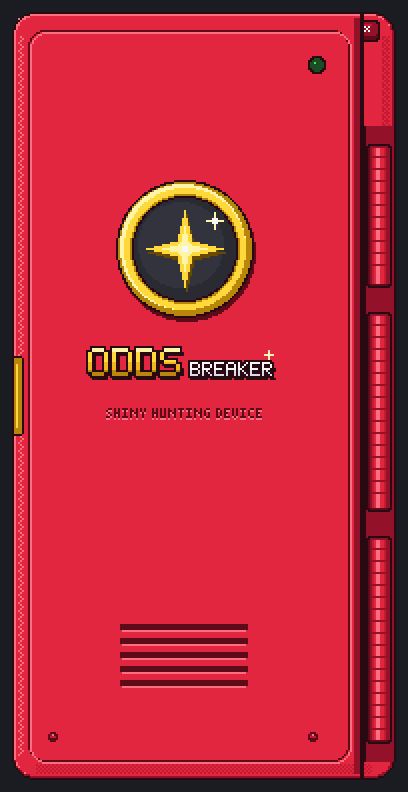
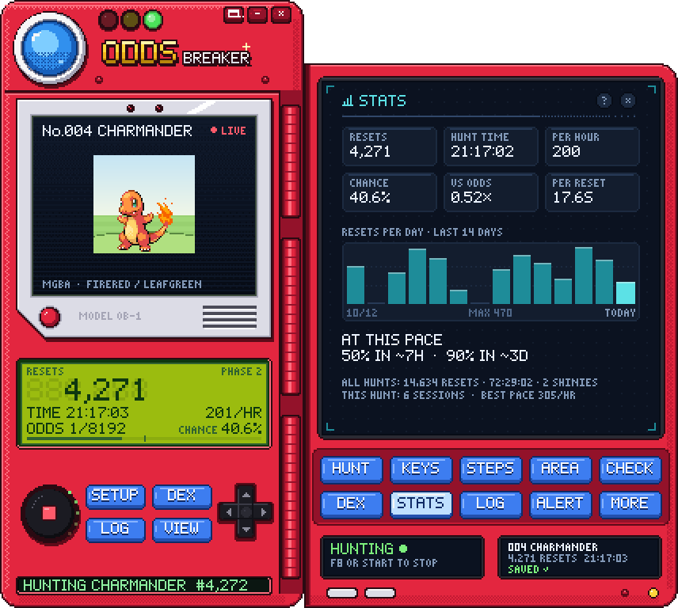
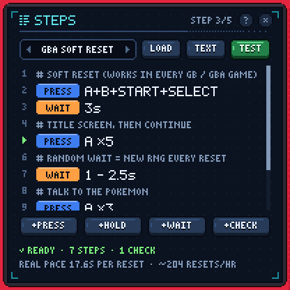
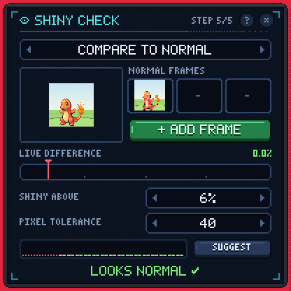
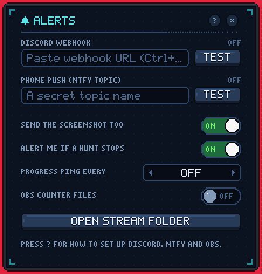
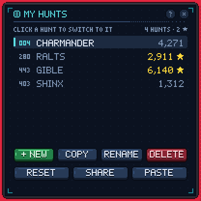
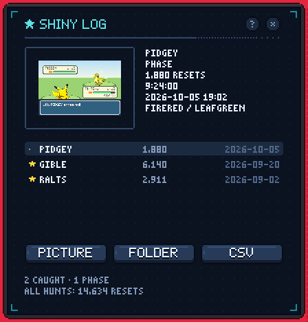
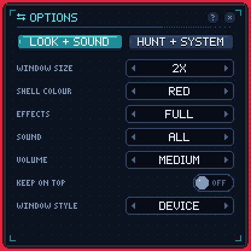
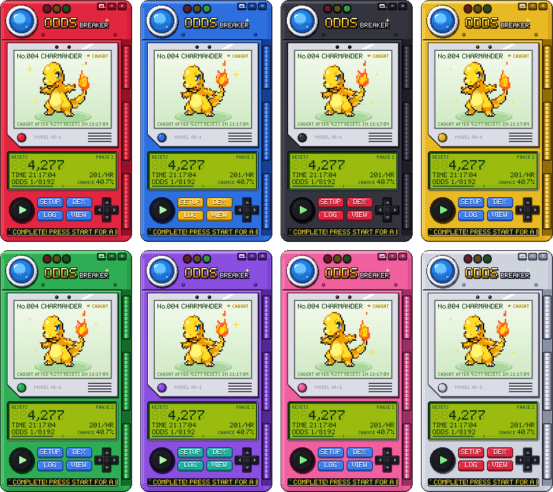
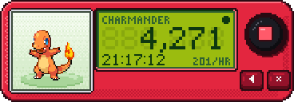

<p align="center">
  
</p>

<p align="center">
  <b>The automatic shiny hunter for any emulator.</b><br>
  It plays the reset loop for you, looks at every encounter and stops with a jingle when a shiny shows up.
</p>

<p align="center">
  <a href="https://github.com/Tahsan228/ShinyHunt/releases/latest"></a>
  
  <a href="https://github.com/Tahsan228/ShinyHunt/actions/workflows/ci.yml"></a>
  <a href="LICENSE"></a>
</p>

<p align="center">
  
</p>

Full-odds shiny hunting means thousands of soft resets. OddsBreaker does the button mashing: it resets the game, walks into the battle, checks the Pokémon's colours and keeps count, so you can get on with your day until it calls you back.

## Download

Get the latest version from the **[Releases page](https://github.com/Tahsan228/ShinyHunt/releases/latest)**.

| File | Best for |
| --- | --- |
| `OddsBreaker-<version>-Setup.exe` | Most people. Installs like any other app, with a Start Menu shortcut and an uninstaller. No admin rights needed. |
| `OddsBreaker-<version>.exe` | One file you can run from anywhere. |
| `OddsBreaker-<version>-Portable.zip` | USB sticks and shared PCs. Your hunts are saved next to the app. |

It runs on Windows 10 and 11 (64-bit) and needs nothing else installed. Once a day it checks for a new version and puts a badge on the **MORE** button when there is one. Install the new version over the old one and your hunts stay where they are.

> [!NOTE]
> The first time you run it, Windows may say **"Windows protected your PC"**. That's SmartScreen being careful with an app that isn't code-signed yet. Click **More info**, then **Run anyway**. Every release comes with a `SHA256SUMS.txt` if you want to check your download.

## Your first hunt

You set up each hunt once. The **SETUP** button takes you through five pages in order and tells you what's still missing.

1. **HUNT**: type the Pokémon, pick the game (that sets the odds) and your emulator, then choose the emulator's window from the list.
2. **KEYS**: the keyboard key your emulator uses for each button. mGBA, VBA-M, DeSmuME, melonDS, Azahar/Citra and RetroArch fill in their usual keys for you.
3. **STEPS**: the loop it plays. Start from a template (GBA, DS or 3DS soft reset, your emulator's reset key, or a save state loop) and adjust the waits for your game. **TEST** plays it once so you can watch.
4. **AREA**: drag a box around the spot where the Pokémon appears in battle.
5. **CHECK**: pause on a normal one and press **ADD FRAME**. Every encounter gets compared against it.

Then press **START** (or **F8** from anywhere) and let it run. It only presses keys while your emulator is the active window, so clicking somewhere else pauses the hunt and clicking back picks it up again.

When an encounter looks shiny it stops, saves a screenshot, plays a jingle, jumps to the front and sends your alerts. Then you tell it what happened: **CAUGHT!** finishes the hunt, **PHASE** logs a shiny you weren't after and keeps going, and **NOT SHINY** carries on after a false alarm.

<p align="center">
  
</p>

## What's inside

|  |  |  |
| :-: | :-: | :-: |
| **Steps** you can read at a glance | **Shiny check** with a live meter | **Alerts** for Discord and your phone |
|  |  |  |
| **Every hunt** keeps its own count and setup | **Shiny log** with a picture of each find | **Options** for size, colour, sound and hotkeys |

- **Works with any emulator that runs in a window.** It types like a keyboard and looks at the screen like a screenshot. No plugins, no memory reading, no patched ROMs.
- **Numbers that mean something.** Resets, hunt time, pace per hour and your chance of having found it by now, plus a STATS page with resets per day, how long until 50% and 90%, your best pace and your luck so far.
- **Alerts wherever you are.** A Discord message with the screenshot, a push to your phone through [ntfy](https://ntfy.sh), a heads-up if a hunt stops on its own and an optional progress ping every so many resets.
- **Made for streaming.** Text files for OBS with the count, odds, pace, phase and status, plus the Pokémon's sprite.
- **Handy extras.** Auto-stop after 1 to 12 hours, SUGGEST to pick a safe shiny threshold from your real scores, hunt codes to share a setup with a friend, CSV export and a daily backup of your save.

## Make it yours

<p align="center">
  
</p>

Pick the shell colour, the window size (1x to 4x), the sounds and how much animation you want under **MORE**. Effects go down to LITE or OFF for slower PCs. Mini mode, the small button in the top corner, swaps the Pokédex for a little counter you can park anywhere:

<p align="center">
  
</p>

## Hotkeys

| Key | What it does |
| --- | --- |
| **F8** | Start or stop, from any window |
| **F9** | Add one to the count, from any window (for hunts you play by hand) |
| **Space** | Start or stop while OddsBreaker is focused |
| **+** and **-** | Add one or take one off |
| **←** and **→** | Previous or next hunt |
| **F1** | Help |
| **Esc** | Fold the panel away |

You can change F8 and F9 or turn them off under **MORE > HUNT + SYSTEM**, and add keys for -1 and mini mode there too. Pick keys your emulator doesn't use. The d-pad on the device does the same as the arrow keys and +/-.

## Your files

Hunts, settings, screenshots and backups live in `%APPDATA%\OddsBreaker`. **MORE > DATA FOLDER** opens it.

| In there | What it is |
| --- | --- |
| `profiles.json` | Your save. It saves by itself as you go, and every few seconds while hunting. |
| `backups\` | A copy of the save from each of the last 14 days. |
| `shinies\` | A screenshot of every shiny. |
| `stream\` | The OBS files, once you turn them on under **ALERT**. |
| `logs\` | Error logs, handy for bug reports. |

The portable version keeps all of this in an `OddsBreaker_data` folder next to the app. Any copy turns portable if you put an empty file called `portable.txt` next to it. Uninstalling removes the app and leaves your hunts alone.

**Coming from ShinyDex?** That's this app's old name. On first start OddsBreaker looks for your old `ShinyDex_data` folder and offers to bring your hunts over. You can also do it later with **MORE > IMPORT SAVE**.

## Troubleshooting

**The keys don't do anything.** Check the KEYS page against your emulator's input settings. If the emulator runs as administrator, run OddsBreaker as administrator too, because Windows blocks key presses into apps with higher rights.

**It keeps pausing.** It only plays while the emulator is the active window, so leave the emulator focused while it hunts.

**The watch area is black.** Some emulators draw in a way screenshots can't see, usually in exclusive fullscreen. Use windowed mode or try another video driver in the emulator's settings.

**It stops on normal ones.** Raise the red line on the CHECK page, or press SUGGEST after a few resets. Animated sprites need 2 or 3 normal frames.

**It never stops.** Lower the red line and make sure the watch area covers the Pokémon itself. Press TEST and watch the live meter while a normal one is on screen.

**My antivirus complains.** Apps built with PyInstaller get flagged by mistake now and then. Only download from the Releases page and compare the checksum in `SHA256SUMS.txt`, or run it from source.

Still stuck? [Open an issue](https://github.com/Tahsan228/ShinyHunt/issues/new/choose) and attach `logs\oddsbreaker.log` from the data folder.

## Run or build it from source

You need Python 3.9 or newer from [python.org](https://www.python.org/downloads/) (it comes with Tkinter). The app only uses the standard library.

```bash
git clone https://github.com/Tahsan228/ShinyHunt.git
cd ShinyHunt
python OddsBreaker.pyw
```

`python -m oddsbreaker --help` lists the options, like `--data DIR` to keep your hunts somewhere else. Pressing keys and reading the screen use Windows APIs, so on macOS and Linux it opens in demo mode with a pretend emulator.

Tests and the release build:

```bash
pip install -r requirements-dev.txt
python -m pytest                        # unit tests plus a full run through the UI
python -m oddsbreaker --selftest out    # clicks through every page and saves screenshots to out/
python packaging/build.py --exe         # OddsBreaker.exe with PyInstaller (on Windows)
python packaging/build.py --package     # installer, portable zip and checksums (needs NSIS 3)
```

Releases build themselves. Bump `__version__` in `oddsbreaker/__init__.py` and add a section to [CHANGELOG.md](CHANGELOG.md), then open **Actions > Release > Run workflow** and tick **Publish** (pushing a tag like `v1.0.1` works too). GitHub Actions runs the tests, builds the app, self-tests the .exe on Windows and publishes the release with all three downloads. The pictures in this README come from `tools/screenshots.py`.

## Credits

Made by **Tahsan**.

Pokémon sprites come from the [PokeAPI sprite collection](https://github.com/PokeAPI/sprites) and are downloaded the first time they're needed. The Pokédex art, pixel fonts, sounds and effects are all made in code for this app.

## License

MIT. See [LICENSE](LICENSE).

OddsBreaker is an unofficial fan project and isn't affiliated with or endorsed by Nintendo, Game Freak, Creatures or The Pokémon Company. Pokémon and all related names are trademarks of their owners. OddsBreaker only presses keys and looks at the screen. It never touches your game's memory or save files.
